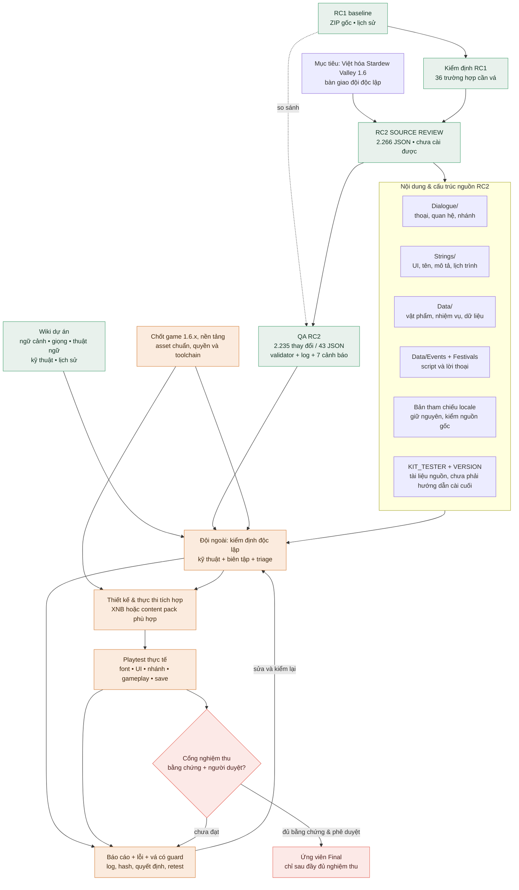

# Graphmap — bản đồ dự án Việt hóa Stardew Valley

Trạng thái tham chiếu: RC2 SOURCE REVIEW 23/10/2026. Sơ đồ mô tả quan hệ và điểm chặn, **không khẳng định các cổng chưa làm đã đạt**. Mermaid được hỗ trợ trong GitHub, nhiều trình đọc Markdown và các công cụ Mermaid. Bản nguồn sơ đồ riêng: `graphmap.mmd`.

## Bản đồ thao tác

| Nút | Đầu vào | Việc cần kiểm | Đầu ra / trạng thái |
| --- | --- | --- | --- |
| RC1 → kiểm định → RC2 | ZIP RC1 + báo cáo RC1 | Không nhầm lỗi đã báo với lỗi chưa vá; so `changes.json` | RC2 là nguồn mới nhất, chưa Final |
| RC2 → QA | ZIP RC2 và RC1, Python 3 | Chạy validator, xem phạm vi và các ngoại lệ | Kiểm định tĩnh có sẵn; không thay thế game thật |
| Wiki → biên tập | Trang 2/3/4/5/7/9/12/13 và 14/15 | Xung đột chuẩn, bối cảnh, tên, đại từ, token | Người có thẩm quyền chốt và ghi quyết định |
| Đầu vào game → tích hợp | Game hợp pháp + đúng 1.6.x, nền tảng và toolchain | Mapping asset, kiểu dữ liệu, cơ chế nạp | Chưa có pipeline hay gói cài đã xác minh |
| Build → playtest | Build cài thử + save thử được sao lưu | UI, font, sự kiện, nhánh, gameplay, load/save | Log, ảnh, lỗi và kết quả retest |
| Nghiệm thu → phát hành | Báo cáo độc lập, bản build, bằng chứng, quyền | Ký duyệt các cổng và hash gói cuối | Chưa đạt; chỉ gắn Final sau phê duyệt |

Đọc `README_BAN_GIAO.md` cho số liệu, giới hạn, chi tiết và checklist đầy đủ; đọc `WIKI_VA_QUYEN_TRUY_CAP.md` để mở wiki.
